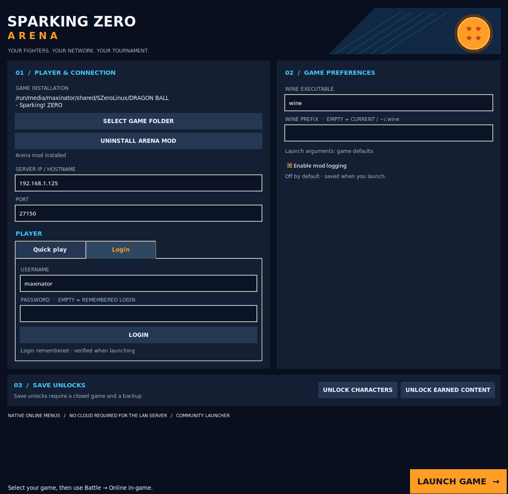
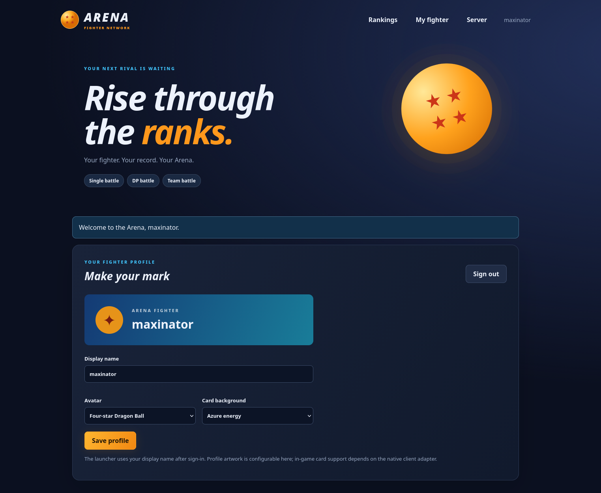

# Sparking ZERO Arena

A community LAN multiplayer mod, standalone launcher, and self-hosted server
for **DRAGON BALL: Sparking! ZERO**. Use the game's **Battle → Online** menus
with your own Arena server for matchmaking, rooms, accounts and LAN rankings.
Clients enter one server address; no hosts-file changes are required.

**Experimental.** Quickmatch and ordinary lobbies have worked in two-PC tests.
Ranked combat has also worked, but leaving its result screen can still cause
a black screen/network error on the other player. The latest persistent-rating
changes pass integration tests and still need verification in the actual game.

[Download the full package](https://github.com/maxinatorixx/Sparking-Zero-LanMod/releases)
· [Code map](lan/README.md) · [Deployment details](lan/DEPLOYMENT.md)
· [Accounts and database](lan/ACCOUNTS.md)

## Screenshots

### Launcher



### Website



## Requirements
- Windows, or Linux with Wine configured to run that installation.
- Docker Engine/Desktop with Docker Compose on the server machine.
- Matching Arena client/server versions and compatible game versions/settings.

The release contains one-file Windows and Linux launchers. **Players do not
need to install Python.** The server runs the game service, website and MariaDB
inside one container. Linux still needs Wine to run the Windows game.

## Install and start the server

1. Download and extract **SzeroLAN-Arena.zip** from Releases. Keep the extracted
   `server/` directory together.
2. Inside `server/`, copy `.env.example` to `.env` and fill in:

   ```dotenv
   ARENA_ADMIN_TOKEN=choose-your-admin-token
   ARENA_DB_PASSWORD=choose-your-app-db-password
   ARENA_DB_EDITOR_PASSWORD=choose-your-editor-db-password
   ```

   Each value must contain at least two characters. Keep `.env` private.
3. Run from that directory:

   ```sh
   docker compose up -d --build
   ```

   `docker-compose up -d --build` also works. The server does not generate `.env`
   and does not require a separate start script.
4. Open `http://SERVER-IP:8080`. Register the first account using your admin
   token to create the administrator. Later accounts need only a username and
   password; no email confirmation is required.

To run directly from a source checkout, use the same steps inside `lan/` instead
of `server/`. First database initialization can take a little time.

### Ports and persistent data

| Purpose | Default host port | Notes |
| --- | --- | --- |
| Game, launcher login and relay | TCP **and** UDP 27150 | Use this address/port in the launcher. |
| Website | TCP 8080 | Can sit behind an HTTP reverse proxy. |
| MariaDB editor access | TCP 3306 | Database `arena`, user `arena_editor`, password `ARENA_DB_EDITOR_PASSWORD`. |

Bindings default to `0.0.0.0`. Change host ports/bind addresses in `.env`.
The application uses the separate database user `arena`; database root access
is local to the container. Set `ARENA_DB_BIND_IP=127.0.0.1` if external editor
access is unnecessary. Named Compose volumes retain accounts, ratings and logs.
**Do not use `docker compose down -v` unless you intend to erase those volumes.**

The website supports reverse-proxy roots or subpaths; see
[ACCOUNTS.md](lan/ACCOUNTS.md#reverse-proxy). An HTTP reverse proxy does not
proxy the game TCP/UDP port. Game-port login is currently plain TCP, so use a
trusted LAN/VPN; website HTTPS alone does not encrypt launcher login traffic.

## Install and launch each client

1. Start `SzeroLAN-Windows.exe` on Windows. On Linux:

   ```sh
   chmod +x SzeroLAN-Linux
   ./SzeroLAN-Linux
   ```

2. Click **Select game folder**, select the installed game directory, and click
   **Install Arena Mod**. Other controls are enabled after selecting a game.
   The bundled, pinned UE4SS loader is installed as needed.
3. Enter the server PC's IP/hostname and game port, normally `27150`.
4. Choose **Quick play** for casual play, or **Login** for an Arena account.
   Ranked requires login. Login uses the same game address/port, and your
   website display name becomes the player's name.
5. On Linux, select Wine and optionally its prefix. An empty prefix uses the
   current/default Wine prefix, normally `~/.wine`.
6. Click **Launch Game**. Login is checked first and a failed login stops launch.
   Settings and any existing `UserName=` field in `steam_emu.ini` are updated
   before game processes start. This only changes a display-name setting in an
   already-present file; no platform emulator is supplied or installed.
7. In-game, use **Battle → Online**, then the normal supported mode menus.
   F5/the legacy overlay is not the intended matchmaking flow.

Settings restore on the next run. Draft edits are saved when you click
**Launch Game**, not on every keystroke. Explicit **Login** remembers a scoped
session token; the launcher does not store a new plaintext password.

**Enable mod logging** defaults off. It is for troubleshooting; networking and
ranked result reporting work with it off. UE4SS's own engine log is separate.
Closing/killing the launcher tears down its bridge; abrupt termination can
prevent a graceful disconnect message, so the server also handles socket loss.

## Current support

| Feature | Status |
| --- | --- |
| Native casual quickmatch and actual battles | User-confirmed working. |
| Ordinary lobby creation, joining and battles | User-confirmed working. |
| Private-slot lobbies | Implemented; needs fresh end-to-end verification of all slot settings. |
| Player cards | User-confirmed working; artwork and detailed statistics have native-format limits. |
| Ranked matchmaking and combat | Combat user-confirmed; result-menu exit still has a known failure. |
| Persistent LAN Elo, counts and expanding Elo matching | Implemented and integration-tested; latest native reporting needs a two-PC game test. |
| Online tournaments | Up to eight members/targeted relay implemented and tested; complete brackets/battles are not confirmed. |
| Accounts, profile settings, website rankings, admin logs/restart | Implemented and tested with real MariaDB/container restarts. |
| Save unlocks | Supported existing-save formats only; Linux user-confirmed, Windows fixes need further user verification. |
| Arbitrary game builds, every online backend feature, official ranks/seasons | Unsupported. |

### Ranked behavior and known result-screen error

LAN Elo starts at **1000**, uses **K=32**, and stores separate Single, DP and Team
records. Two authenticated participants must report complementary typed
Win/Lose or Draw/Draw results for the same issued round and category. The server
commits ratings/counters once; retries do not award points twice. Missing,
conflicting or same-account reports do not award points. This LAN Elo is separate
from official game rank titles/thresholds.

For verified Ranked Single/DP searches, the allowed difference starts at **±100**,
grows by **100 every 15 seconds** to **±600**, and allows any rating after
**120 seconds**. Longer waits take priority, then closer ratings. The game's
native battle/settings filters still apply. Edit `elo_matchmaking` in
`server.example.json` to change the policy, then restart the service.

The game's Single/DP statistics are populated from confirmed LAN lifetime counts.
Both native period views use those lifetime totals; there is no seasonal reset.
The first finisher can receive old counters while the peer's report is pending;
fresh profile/card requests retrieve the committed totals. Most-used fighter
history and official rank progression are not invented.

**Known issue:** when the room creator leaves the Ranked result screen, the
other player can enter a black screen and receive a network error. The creator's
departure currently tears down the native session. Keeping an ownerless/ghost
room alone is not a verified exit/rematch fix. The proper handshake remains open.
A correctly agreed result is stored independently of that later error. Rematch,
disconnect, surrender and unusual finish flows need further actual-game testing.

### Save unlocks and uninstalling

Close the game before using **Unlock characters** or **Unlock earned content**.
Select an existing supported save, review the confirmation, and keep its backup.
The editor changes recognized gameplay-unlock fields; it does not grant DLC
ownership, edit account ranks, supply saves or unlock platform entitlements.

Use **Uninstall Arena Mod** with the game closed. Own mod payloads/receipt are
deleted without creating new uninstall-backup directories. Original shared-loader
backups and unrelated mods are preserved according to the install receipt.
The stutter patch is no longer integrated into the launcher.

## Updating

Back up your server data first. Preserve `.env`, your server configuration and
Compose volumes, replace server files, then run `docker compose up -d --build`.
Close every game and reinstall **our mod on every client** using the new
launchers. Mixed native helper/protocol versions are unsupported; stale-payload
checks can refuse launch. Never replace the original game EXE/PAK files manually.

## Build from source

The repository includes our native helper binaries and the pinned MIT-licensed
UE4SS dependency/provenance. Native source and MinHook license are included.
No original game executables, PAKs, saves, runtime credentials or logs belong in Git.

### Windows launcher

Install Python **3.13** on the build machine, then run:

```bat
lan\Build-Launcher.cmd
```

This creates a build environment with `lan/build-requirements.txt` and writes
the one-file launcher to `.build/desktop/SzeroLAN-Windows.exe`.
Avoid Python 3.14 for this Windows/Tk/PyInstaller combination.

### Linux launcher

Use Docker for the Ubuntu 22.04/glibc compatibility baseline:

```sh
docker build -f lan/Dockerfile.launcher -t szero-lan-launcher-builder:local lan
mkdir -p .build/desktop
docker run --rm --network none \
  --mount type=bind,source="$PWD/.build/desktop",target=/output \
  szero-lan-launcher-builder:local
```

Alternatively, `bash lan/build-launcher.sh` builds with your system Python/Tk;
that executable inherits your host's compatibility requirements.

### Native helpers, full ZIPs and tests

Native helper rebuilds require MinGW-w64; exact strict compiler commands are in
[lan/native/README.md](lan/native/README.md). Rebuild the launchers after changing
native payloads. Several helpers use instruction signatures and the known game
hash; porting them requires verifying the new ABI/contracts, not changing a hash.

Place **both** platform launchers in `.build/desktop/`, then run:

```sh
python3 lan/build_release.py
python3 lan/build_bundle.py
python3 lan/build_bundle.py --check
```

Distribute the complete `dist/SzeroLAN-Arena.zip` and its SHA-256 file, rather
than loose launchers. The separate experimental source ZIP is for developers.
Tagged `v*` pushes build both launchers and publish a prerelease through GitHub
Actions; the release job alone receives repository-content write permission.

Run Python checks with `python3 -m unittest discover -s lan -p 'test_*.py'`.
Some require Tk/Xvfb, MinGW, disposable Wine, native IPC fixtures, staged desktop
binaries or an explicitly selected test Docker image. See the
[code map](lan/README.md#tests) for opt-in fixture variables. Never point tests
at a live game prefix or production database. The last full local validation
passed 375 Python checks plus six Lua mocks, including legacy local checks not
shipped in the public source. This is not proof of every actual-game flow.

## Legal

Unofficial community project, not affiliated with or endorsed by the game's
publishers or rights holders. Intended for lawful LAN play with legitimately
owned copies, **not piracy, DRM bypass or entitlement circumvention**. No game
files or platform emulators are supplied. Dragon Ball and game trademarks belong
to their respective owners; bundled third-party dependencies retain their own
licenses. Use at your own risk.
