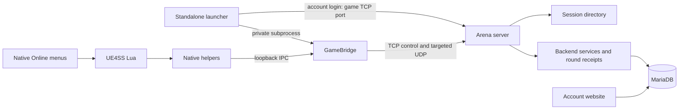

# Arena code map

See the [project README](../README.md) for installation, screenshots, support
status, known failures and build commands. This directory contains the launcher,
native mod, game server and account website. Historical investigation captures
are local evidence, not required runtime dependencies.

## Request flow



The launcher starts the bridge using its own bundled executable; users do not
run Python. UE4SS loads our Lua/native helpers inside the game. Supported
original session/backend calls become bounded local IPC. The bridge owns the
outbound server connection and per-peer local UDP proxies. The game retains
its native menus, selections and battle logic. Server pairing alone does not
force the game into battle.

## Launcher, installation and saves

| File | Responsibility |
| --- | --- |
| `desktop.py` | Frozen entry point, embedded `--bridge` entry, resource/UI self-checks. |
| `setup_launcher.py` | Current launcher UI: select/install/uninstall mod, connection settings, Quick play/Login, launch checks and save unlock confirmations. |
| `launcher_theme.py` | Colors, spacing, themed controls and icon helpers. |
| `launcher_support.py` | Preferences, game command/environment, Wine settings and bridge commands. |
| `account_client.py` | Bounded account requests over the game host/TCP port and scoped remembered sessions. |
| `installer.py` | Build validation, pinned UE4SS extraction, payload hashes, ownership receipt and installation/removal. |
| `lifecycle.py` | Parent lifetime pipe and stop signals; stops bridge when launcher disappears. |
| `game_process.py` | Running-game checks before installation or save edits. |
| `savegame.py`, `save_catalog.py` | Save envelope integrity/decoding/atomic writes and recognized unlock fields. UI supplies confirmation and backup. |
| `launcher.py` | Older lobby client/developer path, not the current frozen launcher UI. |

Launch authenticates first. After success, preferences, game config and the
optional existing `steam_emu.ini` display name are written before processes
start. Explicit Login may remember its token immediately; other drafts save only
on Launch. New plaintext passwords are not persisted. Quick play does not send
a remembered account token. Preflight refuses missing/stale native payloads.

## Bridge, IPC and relay

| File | Responsibility |
| --- | --- |
| `ingame_client.py` | `GameBridge`: config/runtime files, loopback RPC, request forwarding, stop/disconnect cleanup. |
| `native_search.py` | Strict command parsing, `NativeSearchRPC`, transaction lifecycle, owned descriptors and remote UDP proxy assignment. |
| `backend_rpc.py` | Strict `SERVICE1`–`SERVICE5` translation; only approved routes/selected typed fields reach server. |
| `native_session_codec.py` | Descriptor validation/encoding: settings, order, one owner, identities, optional stream and bounds. |
| `lan_identity.py` | Transport identities and descriptor translation for actual LAN peers. |
| `native_identity_diagnostics.py` | Optional bounded identity/admission inspection. |
| `szero_lan.py` (`LobbyClient`) | Shared client TCP control and UDP relay implementation. |

Runtime `.endpoint`, `.policy`, `.lua`, `.ui.lua`, `.stop` and status files may
be control/lifetime IPC rather than logs. Do not delete active files to clear
logs. `SZERO_LAN_MOD_LOGGING=1` enables our diagnostics; missing/0 still executes
network and ranked operations. UE4SS engine logging has a separate owner.

Current multi-member transport uses HELLO5/READY5 with bounded immutable proxy
ports, SESSION4 descriptors and targeted kind4 UDP relay. Up to eight current
participants are supported. A departed identity's proxy is not reassigned in
that process lifetime. Server admission validates registration, partition,
session and current destination membership; packets are not broadcast to every
game. Legacy two-player paths remain in compatible partitions. Mixed helper/
protocol versions are unsupported.

## Native game-side mod

Installed under `SparkingZERO/Binaries/Win64/Mods/SzeroLAN/`, or the detected
`Win64/ue4ss/Mods/SzeroLAN/` variant. `ue4ss/SzeroLAN/` is the source payload.

| File/group | Responsibility |
| --- | --- |
| `scripts/main.lua` inside the payload | Startup, lifetime/config wiring and scheduled native helper polling. |
| `native_search.lua`, `native_menu.lua`, `panel.lua` | Helper/control integration and retained legacy diagnostic panel. Native Battle → Online is the intended play flow. |
| `audit.lua`, `session_trace.lua` | Optional bounded Lua diagnostics. |
| `native/native_search.c` and included `.inc` files | Native session-service adapter, provider/lifecycle/readiness hooks and loopback dispatcher. |
| `native/native_session_{host,adapter,codec,search,inspect,wire}.*` | Service/descriptor ownership, field/ABI inspection, conversion and bounded search/wire contracts. |
| `native/session_materializer.*` | Owned lists/strings/descriptors; capacity, ordering and exactly-one-owner checks. |
| `native/native_lan_{identity,userinfo,transport}.*` | Peer identity/user-info projection and datagram/endpoint integration. |
| `native/backend_adapter.c` | Exact-build backend seam, native responses, login/card/start/end/profile routes, Ranked gate and operational typed result capture. |
| `native/backend_response.*` | Portable bounded native response parsing/projection contracts. |
| `native/service_trace.c` | Optional bounded original-call observer with ABI, thread/build/prefix and restoration guards. |
| `native/vendor/minhook/` | Licensed hook library source. |
| `native/*probe*.c`, `menu_bridge.c` | Earlier investigation tools; not needed to replace current Online menus. |

Compiler commands and ABI notes: [native/README.md](native/README.md). Bundled
DLLs remove the need for end-user compilers. Hash/prefix checks are intentional;
recovered addresses are not portable to other game updates.

The operational backend owns `SetBattleResult`. It captures own Win1/Lose2/Draw3
only within an issued round; a new code resets capture and valid end reporting
seals it for retries. SERVICE5 keeps completion outcome, raw category and typed
result separate. Optional postresult2 tracing skips this setter while backend
owns it, retaining its other17hooks. Ranking does not require logging.

## Server sessions and rankings

| File | Responsibility |
| --- | --- |
| `szero_lan.py` (`GameServer`) | TCP/UDP listeners, bounded clients/messages, account admission, native routing, notifications, relay, cleanup and legacy lobbies. |
| `native_sessions.py` | Create/search/join/update/leave, actual eligibility/compound filters, independent descriptor copies. |
| `native_session_transactions.py` | Prepare/ACK/commit/abort, reservations and rollback to avoid partial native installs. |
| `elo_matchmaking.py` | Ranked-only expanding Elo windows, stable age, account rating cache, cancellation and candidate priority after native eligibility but before result limit. |
| `backend_services.py` | Approved backend responses, fresh profile/card projection, role-bound battle codes, start/end receipts and result reconciliation. |
| `native_rank.py` | Original rank snapshot fields/float bits; preserves native ranks without substituting LAN Elo. |
| `native_profile.py` | Approved badge/proficiency preference updates, separate from match rating. |
| `account_store.py` | MariaDB/SQLite abstraction, passwords/sessions/profiles, native preferences, durable report inbox and transactional Elo/event/counter/streak updates. |

Original compatibility kinds2/3 identify Ranked Single/DP across namespaces;
opaque numeric slots are not guessed as Elo. Defaults: ±100, +100 every15s,
cap±600, unrestricted after120s; longer waits then closer ratings win priority.
Native filters apply first. Configure `elo_matchmaking` in `server.example.json`.
Casual rooms and tournaments retain native filters/order.

Server-owned connection/session state determines accounts, role and round code.
Each valid own report persists and receives an ACK without waiting for the peer.
Complementary typed results in one raw category commit once, fenced by event ID.
Elo1000/K32 and counts/streaks are separate per Single/DP/Team. Completion
outcome1/2 is not win/loss. Unknown/conflicting/self-play reports are unrated.

Native Single/DP statistics project confirmed lifetime counts into both period1/2
views. No seasons or invented rank thresholds/fighter history. Fresh cards/logins
reload committed state. First-end replies may contain old totals until the peer
reports; cached replies remain idempotent.

**Unresolved:** creator departure tears down the session; the remaining result-
screen player receives SessionLeft and can black-screen/error. Retaining a ghost
owner is not a verified graceful exit/rematch handshake. Durable results and
bounded receipts survive first leave, but do not fix that UI flow.

## Website and container

| File/group | Responsibility |
| --- | --- |
| `arena_web.py` | Account/profile/rankings HTTP API, cookie sessions, same-origin writes and restricted admin logs/restart. |
| `web/index.html`, `web/arena.js`, `web/arena.css` | Registration/login, rankings, fighter artwork/settings and admin UI. |
| `web/avatar.svg` | Default website artwork. |
| `arena_supervisor.py` | One-container MariaDB/web/game startup, secret validation, worker restart supervision and shutdown. |
| `Dockerfile`, `.dockerignore` | Explicit server runtime dependencies/context. |
| `compose.yaml`, `.env.example`, `server.example.json` | Deployment, secrets/ports and server configuration templates. |

Website and game service share MariaDB/`AccountStore`. Launcher login uses game
TCP27150, not a separate website URL. Passwords use salted scrypt; sessions use
opaque tokens. Game TCP has no TLS: use trusted LAN/VPN. Website HTTPS does not
secure game-port credentials. DB users/volumes/proxy: [ACCOUNTS.md](ACCOUNTS.md).

## Builds and packaging

`build_desktop.py` freezes `desktop.py` plus Lua, DLLs, UE4SS and icons.
`verify_desktop_payload.py` compares embedded Lua/native/loader resources byte
for byte against source; CI runs it before publishing either platform.
`build_icon.py` prepares the four-star icon. `build-requirements.txt` pins build
dependencies; `Build-Launcher.cmd` and `build-launcher.sh` create environments.
`Dockerfile.launcher` uses the Ubuntu22.04 compatibility baseline for Linux.

`build_release.py` packages both staged onefiles, Docker context, documentation,
screenshots, licenses and checksum manifest. `build_bundle.py` builds/verifies
an explicit developer-source allowlist. Generated builds are ignored by Git;
[tag-triggered CI](../.github/workflows/desktop-build.yml) publishes full ZIPs.
`vendor/` contains the pinned official UE4SS archive/license/provenance. Original
game files are not packaging inputs. The retired stutter integration/payload is
not distributed in the public source or launcher.

## Tests

`test_*.py` covers accounts/API/storage, IPC, eligibility/transactions, relay,
consensus/Elo, installer/ownership, saves, lifecycle, native ABI/response fixtures,
logging and frozen UI/resources. `test_*.lua` mocks Lua contracts; native
`test_*.c` programs exercise compiled contracts without executing the game.
These tests do not prove every actual-game flow works.

```sh
python3 -m unittest discover -s lan -p 'test_*.py'
(cd lan && for test in test_*.lua; do lua "$test" || exit; done)
```

Opt-in checks require prepared fixtures and additional tools:

| Variable | Meaning |
| --- | --- |
| `WINEPREFIX=/tmp/szero-...` | Disposable Wine prefix only; never a user's game prefix. |
| `SZERO_NATIVE_IPC_EXE` | Compiled `test_native_search_ipc.c` executable. |
| `SZERO_SESSION_V3_IPC_EXE` | Compiled `test_native_session_ipc.c` current/legacy executable. |
| `SZERO_DESKTOP_TEST_EXE` | Actual staged Linux onefile. |
| `SZERO_WINDOWS_DESKTOP_EXE`, `SZERO_WINDOWS_TEST_PREFIX` | Actual staged Windows onefile and disposable Wine prefix. |
| `SZERO_DOCKER_TEST_IMAGE` | Explicit test image; cases create isolated containers/volumes. |
| `SZERO_LAN_MOD_LOGGING=1` | Enables evidence checks; quiet-mode cases explicitly override it. |

Use Xvfb for headless Linux/Wine GUI cases. Test decorators and native README
compiler commands document prerequisites. Keep fixtures, loopback listeners and
test databases isolated from live games/accounts.
